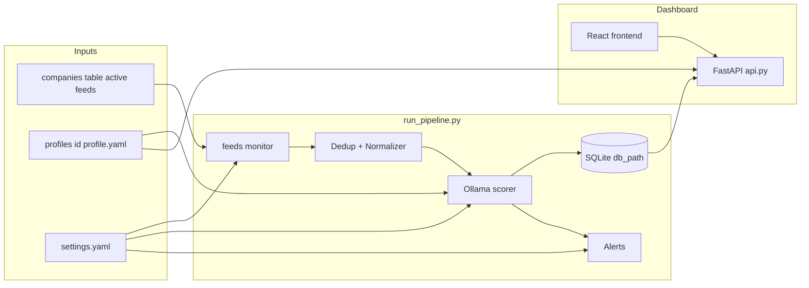

# Project map

## What JobRadar is

A **local-only** pipeline on your Mac: scrape job sites → deduplicate and normalize → score each listing with **Ollama** → store in **SQLite** → optional **ntfy** / Slack / SMTP alerts → browse and update status in a **React + FastAPI** dashboard.

There is **no cloud database** and **no paid LLM API**. The database is a single file on disk (default `db/jobs.db`).

## Repository layout

```text
JobRadar/
├── config/
│   ├── settings.example.yaml   # Template; copy to settings.yaml (gitignored)
│   ├── settings.yaml           # Local: model, db_path, active_profile, alert secrets
│   ├── seed_companies.yaml      # Curated companies for discovery source seed
│   └── profiles/
│       ├── jeff/profile.yaml   # Scorer profile (skills, preferences, weights, alert_threshold)
│       └── example/profile.yaml
├── feeds/                       # RSS/ATS feed fetch + resolver (RawListing)
├── discovery/                 # Company discovery sources (YC, HN, seed, …)
├── pipeline/                   # Dedup, normalize, DB, scorer, alerter, config_paths
├── prompts/                    # LLM system + user templates
├── dashboard/
│   ├── api.py                  # FastAPI backend (/api/*)
│   └── frontend/               # Vite + React + TypeScript
├── db/
│   ├── schema.sql              # SQLite DDL
│   └── migrations/             # Reserved for future schema changes
├── scripts/
│   ├── run_pipeline.py         # Main CLI entry
│   ├── setup.sh                # Legacy step-by-step installer
│   ├── bootstrap_all.sh        # One-shot brew + venv + DB + tests (+ optional ollama pull)
│   └── install_launchd.sh      # macOS scheduled runs
├── tests/
└── docs/                       # This folder
```

## Runtime data flow



1. **`run_pipeline.py`** loads **settings** and the active **profile** (see below).
2. **`feeds/monitor.py`** loads **active company feeds** from SQLite and returns **`RawListing`** objects.
3. **Dedup** hashes title + company + city (with fallback); skips rescoring if the same hash was scored within **7 days**. Separately, **`max_listing_age_days`** in settings (default **7**) drops scraper rows whose **posted** date parses and is **strictly older** than that; missing/unparseable posted dates are kept.
4. **Normalizer** fills salary, location, remote, posted date fields for storage and prompts.
5. **Scorer** calls Ollama with **`prompts/scoring_*.txt`** and the profile YAML; writes fit/pref/comp + **weighted overall** (weights from profile).
6. **Alerter** sends ntfy/Slack/email when overall ≥ **alert_threshold** (from profile), using secrets under **`profiles.<id>`** in settings.
7. **Dashboard** (FastAPI + React) reads the same SQLite file via `/api` and can **re-score** a row with the current profile.

## Active profile resolution

Precedence (highest first):

1. **`python scripts/run_pipeline.py --profile <id>`**
2. **Environment** `JOB_SEARCH_PROFILE`
3. **`active_profile`** in `config/settings.yaml`

Profile file path: **`{profiles_dir}/{id}/profile.yaml`**, with `profiles_dir` defaulting to `config/profiles`.

The dashboard uses **`JOB_SEARCH_PROFILE_DASHBOARD`** if set; otherwise the same resolution as above.

## Database

| Item | Detail |
|------|--------|
| Engine | SQLite 3 |
| Default path | `db/jobs.db` (relative to repo root) |
| Override | `db_path` in `config/settings.yaml` |
| Schema | `db/schema.sql` — table `listings` (hash unique, scores, status, notes, timestamps) |

**Multi-profile caution:** If two people share one machine but use different `--profile` values **without** different `db_path` values, listings from both profiles can end up in the same table. Use separate `db_path` (or separate clones) until/unless you add a `profile_id` column.

## Key entry points

| Goal | Command |
|------|---------|
| Full setup (machine) | `bash scripts/bootstrap_all.sh --no-model-pull` |
| One pipeline run | `source .venv/bin/activate && python scripts/run_pipeline.py --verbose --profile jeff` |
| UI (dev) | `bash scripts/dev.sh` → http://localhost:5173 |
| Tests | `pytest tests/ -v` |
| Logs | `~/Library/Logs/job-search-agent/pipeline.log` (and launchd logs if installed) |

## Related docs

- [Configuration](configuration.md) — YAML files and secrets
- [AGENTS.md](../AGENTS.md) — coding and testing conventions for contributors and AI agents
