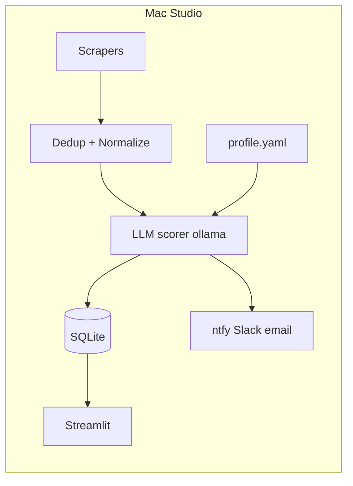

# Automated job search agent — implementation plan

## Scope and constraints

- **Source of truth**: [job-search-agent-prompt.md](c:\Projects\JobRadar\job-search-agent-prompt.md) (structure, datatypes, SQL, prompts, pipeline flow, error handling, tests).
- **Workspace**: Implement at repo root `[c:\Projects\JobRadar](c:\Projects\JobRadar)` using the folder layout from the prompt (`config/`, `scrapers/`, `pipeline/`, etc.) — no need to rename the repo to `job-search-agent/`.
- **Production**: macOS only — `launchd` plist, logs under `~/Library/Logs/job-search-agent/` per spec. On Windows, run pipeline and tests locally; scheduling and default log directory assume Mac (document or use a small env override like `JOB_SEARCH_LOG_DIR` only if needed for dev ergonomics).
- **Secrets**: Keep ntfy topic, Slack webhook, SMTP in `[config/settings.yaml](c:\Projects\JobRadar\config\settings.yaml)` and **gitignore** that file; ship `[config/settings.example.yaml](c:\Projects\JobRadar\config\settings.example.yaml)` with placeholders.

## Architecture (from prompt)

## Phase 1 — Foundation (DB + config + logging)

- Add `[db/schema.sql](c:\Projects\JobRadar\db\schema.sql)` exactly as specified in the prompt (table `listings`, indexes).
- Add `[config/profile.yaml](c:\Projects\JobRadar\config\profile.yaml)` from the prompt’s example (user-edited; do not modify programmatically).
- Add `[config/sources.yaml](c:\Projects\JobRadar\config\sources.yaml)` and `[config/settings.yaml](c:\Projects\JobRadar\config\settings.yaml)` (model name, thresholds, timeouts, alert toggles, optional email digest preference). Match prompt concepts: `alert_threshold` can live in profile as in doc or centralize in settings — pick **settings** for ops and keep **profile** for scoring content + `scoring_weights` as in doc (if duplicated, single source of truth in profile for weights and threshold for scorer/alerter reads).
- Shared **config loader** (YAML) and path resolution from project root.
- **Logging**: `logging` with console + `RotatingFileHandler` to `~/Library/Logs/job-search-agent/pipeline.log` on Mac; INFO default, DEBUG via `--verbose` on `[scripts/run_pipeline.py](c:\Projects\JobRadar\scripts\run_pipeline.py)`.

## Phase 2 — Core pipeline types and dedup/normalize

- Define `**RawListing`** and normalized structs (e.g. `SalaryRange`, normalized listing for DB) in a small `pipeline/models.py` or adjacent module — match prompt fields (`raw_html`, `scraped_at`, etc.).
- `[pipeline/dedup.py](c:\Projects\JobRadar\pipeline\dedup.py)`: hash = normalized title + company + city (per spec: lowercase, strip, remove punctuation). DB check: if hash exists and **scored within 7 days**, skip; if older, re-score.
- `[pipeline/normalizer.py](c:\Projects\JobRadar\pipeline\normalizer.py)`: salary parsing, location/remote detection, relative posted-date parsing as specified.

## Phase 3 — Scorer (highest priority)

- Add `[prompts/scoring_system.txt](c:\Projects\JobRadar\prompts\scoring_system.txt)` and `[prompts/scoring_user.txt](c:\Projects\JobRadar\prompts\scoring_user.txt)` per prompt (verbatim JSON contract and `{{profile}}` / listing fields).
- `[pipeline/scorer.py](c:\Projects\JobRadar\pipeline\scorer.py)`:
  - `ollama` client, `format="json"`, `temperature=0.1`, **30s timeout** per listing.
  - Retry JSON parse **once**; then log raw response and skip.
  - Validate ints 0–100; compute `overall = w1*fit + w2*pref + w3*comp` in Python from `[config/profile.yaml](c:\Projects\JobRadar\config\profile.yaml)` weights.
  - **Resilience**: if ollama unreachable, log clearly; optional “start ollama” behavior can be a documented manual step first — subprocess `ollama serve` is fragile for automation; plan to **detect + log + skip** unless you explicitly want a best-effort `subprocess` start on Mac only.
- **Tests**: `[tests/test_scorer.py](c:\Projects\JobRadar\tests\test_scorer.py)` with **mocked ollama** responses; `[tests/fixtures/](c:\Projects\JobRadar\tests\fixtures/)` JSON listings; assert JSON validity, bounds, and weighted overall math. `[tests/test_dedup.py](c:\Projects\JobRadar\tests\test_dedup.py)` and normalizer tests as in prompt.

## Phase 4 — Scrapers (base + Indeed first)

- `[scrapers/base.py](c:\Projects\JobRadar\scrapers\base.py)`: async-friendly patterns, **2–5s random delay** (LinkedIn branch can use 5–10s per source config), UA rotation, **3 retries** with 5s/15s/45s backoff, request logging (URL, status, time), returns `list[RawListing]`.
- `[scrapers/indeed.py](c:\Projects\JobRadar\scrapers\indeed.py)`: **httpx + selectolax** first; structure for playwright fallback if needed.
- Wire **one** end-to-end path in `[scripts/run_pipeline.py](c:\Projects\JobRadar\scripts\run_pipeline.py)`: load sources → run enabled scrapers in isolation (**try/except per source**, continue on failure) → dedup → normalize → score → upsert SQLite in **transactions**.
- **Stubs or minimal implementations** for `[scrapers/linkedin.py](c:\Projects\JobRadar\scrapers\linkedin.py)`, `[scrapers/glassdoor.py](c:\Projects\JobRadar\scrapers\glassdoor.py)`, `[scrapers/career_pages.py](c:\Projects\JobRadar\scrapers\career_pages.py)` can come after Indeed works; LinkedIn: prefer **RSS or public search** first with aggressive delays as warned in prompt.

## Phase 5 — Alerting

- `[pipeline/alerter.py](c:\Projects\JobRadar\pipeline\alerter.py)`: ntfy primary (httpx POST with Title/Click/Tags/Priority), optional Slack webhook JSON, optional SMTP **digest** for above-threshold listings (config-driven).
- Read threshold from profile/settings consistently with scorer output.

## Phase 6 — Dashboard

- `[dashboard/app.py](c:\Projects\JobRadar\dashboard\app.py)` Streamlit on port 8501:
  - Filters: sub-scores, overall, status, source, remote.
  - Expandable row: description, three reasons, link.
  - Status transitions + notes persisted to SQLite (parameterized updates).
  - Summary stats + histogram + time series by day/source.
  - **Re-score** button: re-run scorer for one row with current profile, update DB.

## Phase 7 — Scheduling + setup

- `[scripts/install_launchd.sh](c:\Projects\JobRadar\scripts\install_launchd.sh)`: generate plist for **every 3 hours**, `KeepAlive` false, cwd = project root, logs to `~/Library/Logs/job-search-agent/`, install to `~/Library/LaunchAgents/com.jobsearch.agent.plist`, `launchctl load`, verify `launchctl list`.
- `[scripts/setup.sh](c:\Projects\JobRadar\scripts\setup.sh)`: brew [python@3.12](mailto:python@3.12) + ollama, pull model, pip install, playwright chromium, sqlite init, reminder to edit profile, call install script.

## Phase 8 — Polish and integration test

- `[pyproject.toml](c:\Projects\JobRadar\pyproject.toml)` + `[requirements.txt](c:\Projects\JobRadar\requirements.txt)` per prompt (add `pytest` for tests).
- **Integration test**: mocked scraper returning fixtures → full insert + score path (mock ollama) → assert DB rows.
- **Future hook** (optional, not blocking MVP): freshness job to mark `expired` on 404 — noted in prompt; can be a follow-up.

## Alignment with [AGENTS.md](c:\Projects\JobRadar\AGENTS.md)

- Type hints, dataclasses for domain objects, async scrapers / sync DB and orchestration, parameterized SQL, no credentials in code — same as workspace rules.

## Verification

- Run `pytest tests/ -v` after implementation; manual smoke: `python scripts/run_pipeline.py` (with ollama running on a Mac or dev machine), `streamlit run dashboard/app.py`.

